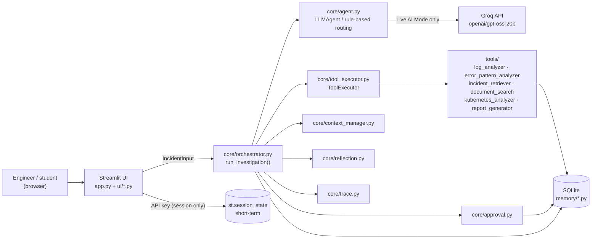
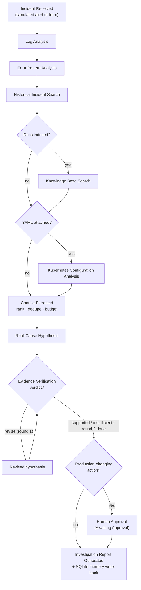
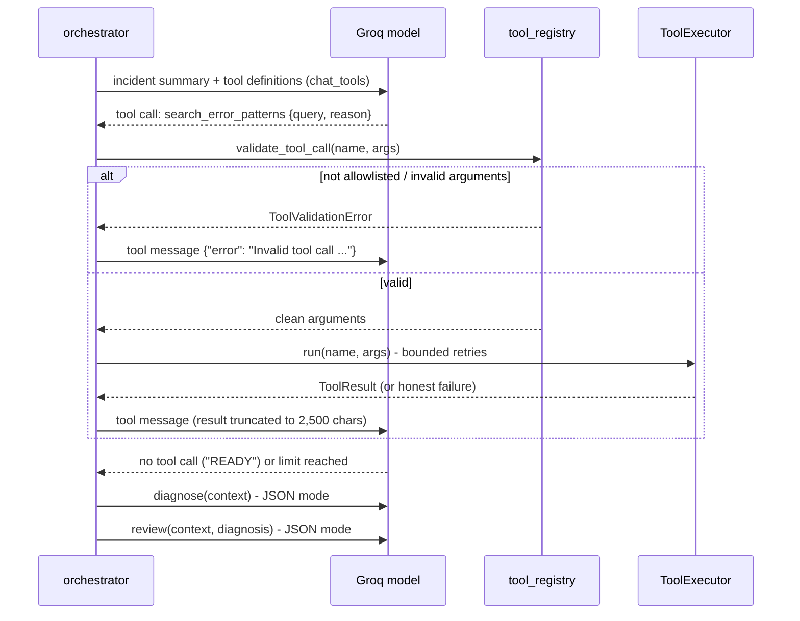
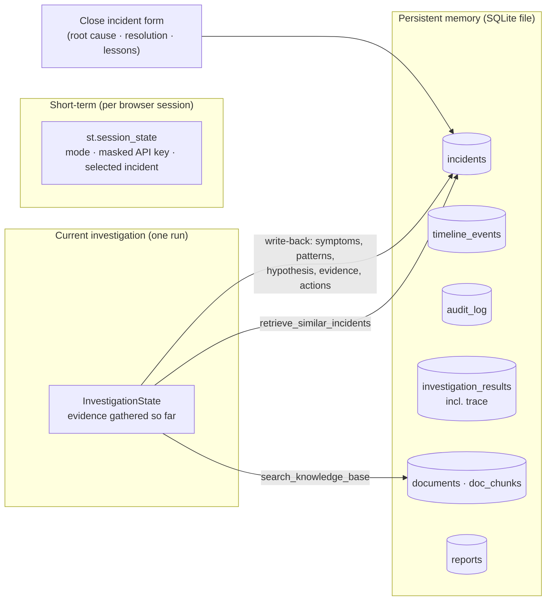
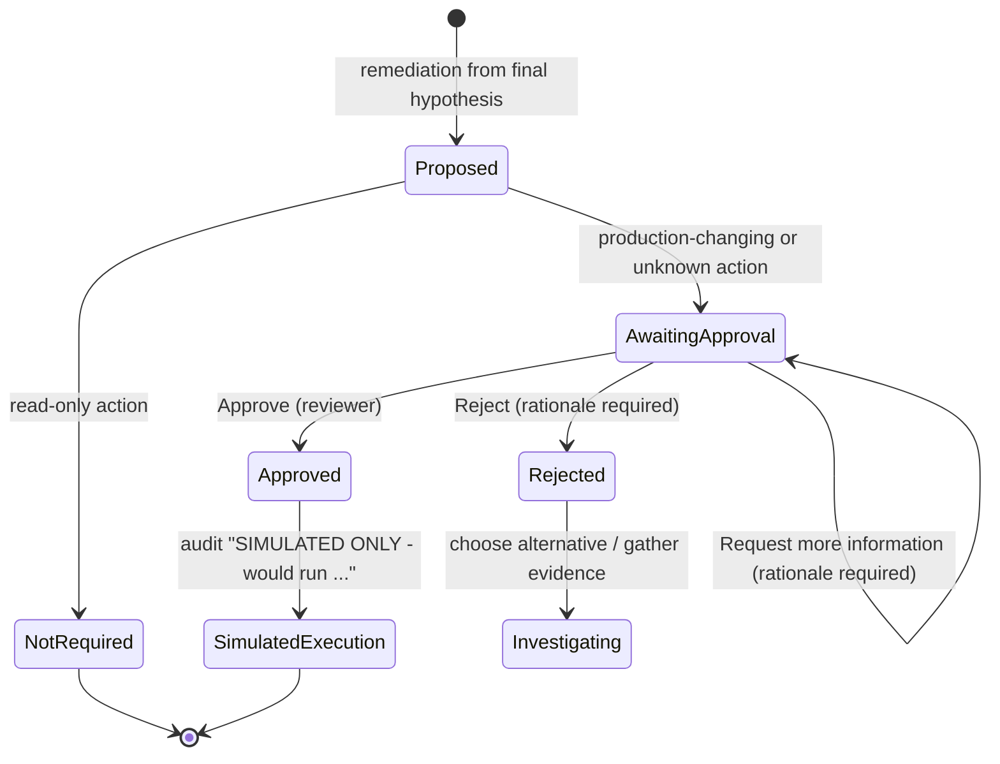
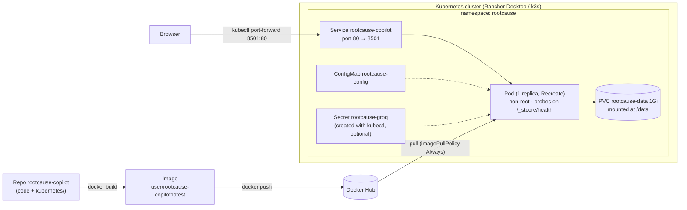
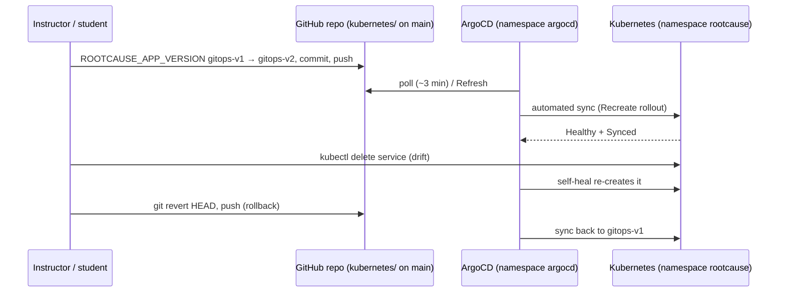

# RootCause Copilot v1.1 - Architecture

RootCause Copilot is a **modular monolith**: one Python process (Streamlit) with clear internal boundaries. Nothing
about the Day 4 concepts needs microservices, and students can read the whole system. Every name in the diagrams
below is a real module or function in this repository.

## 1. Overall application architecture

| Package | Responsibility |
|---|---|
| `app.py`, `ui/` | Navigation, pages, sidebar **AI Configuration**, page-level error boundary |
| `core/` | Workflow (`orchestrator`), agent, tool registry/executor, context, reflection, approval, events, trace, Groq client, safe logging |
| `tools/` | Deterministic tools - they compute facts; they never call the LLM |
| `memory/` | SQLite schema, migrations and repositories |
| `config.py` | Fixed provider/model, paths, limits, labels |

## 2. RootCause Agent workflow (one investigation)

The order above is the **Demo Mode** (rule-based) order. In **Live AI Mode** the model chooses which tools to call
and in which order; steps it does not need are shown as **Skipped** in the trace. Every step's status, real
timestamp, measured duration and *origin* are recorded by `core/trace.py`:

| Origin label | Meaning |
|---|---|
| `executed (deterministic code)` | Python code really ran (tools, context, checks, report) |
| `executed (Groq LLM call)` | the model produced this result live |
| `executed (rule-based heuristic - no AI)` | Demo Mode heuristic for inputs without a prepared result |
| `SIMULATED DEMO RESULT (predefined - no AI reasoning)` | prepared output for a bundled sample incident |
| `human decision (simulated approval workflow)` | approve / reject / more information |

Statuses: **Pending** (never reached), **Running**, **Completed**, **Failed**, **Skipped** (with the reason),
**Awaiting Approval**. Nothing is invented: a step that did not run has no timestamp and no duration.

## 3. Tool-calling architecture

- Allowlisted tools: `analyze_logs`, `search_error_patterns`, `retrieve_similar_incidents`, `search_knowledge_base`,
  `analyze_kubernetes_yaml`; `generate_investigation_report` is orchestrator-only.
- Limits (`config.py`): 8 tool calls, 10 model turns, 2 reflection rounds, 9,000-character context budget,
  45 s API timeout, 2 bounded retries for transient errors only.
- `openai/gpt-oss-20b` on Groq supports tool use and JSON mode, but not parallel tool calls; JSON-schema structured
  outputs cannot be combined with tool use. Hence: native tool calling for tool choice, JSON mode + Python
  validation for diagnosis and review. An invalid model tool call (`tool_use_failed`) makes that one step use
  rule-based routing, and the timeline says so.
- There is no shell, file-system, network or infrastructure tool. The model cannot execute anything.

## 4. Incident memory architecture

- Retrieval score (`tools/incident_retriever.py`): `0.45 × keyword overlap + 0.35 × log-pattern overlap +
  0.20 × same service`; only incidents with a recorded root cause or resolution are returned.
- Knowledge base: keyword TF-IDF over chunks with a **relevance filter** (`KB_MIN_MATCHED_TERMS = 2`): if nothing
  is relevant, nothing is placed in the model's context.
- `init_db()` creates the schema, **migrates** v1.0 databases in place (new columns `supporting_evidence`,
  `recommended_actions`, `evidence_assessment`) and loads fictional seed history once.
- Database path: `$ROOTCAUSE_DATA_DIR/rootcause.db` (default `./data_store/`, git-ignored; `/data` in Kubernetes).

## 5. Human-in-the-loop approval

Every decision is appended to `audit_log` (investigation ID, action, decision, reviewer, timestamp, rationale,
simulated execution note) and reflected in the saved trace. Risk levels come from `core/schemas.ACTION_RISK`
(unknown action types are **High** and always require approval).

## 6. Day 5 Docker / Kubernetes deployment

One replica on purpose: SQLite on a single `ReadWriteOnce` volume is not a shared, multi-writer database.
Production designs would use PostgreSQL or a managed database (deliberately deferred).

## 7. ArgoCD GitOps workflow

One repository: application code and desired state (`kubernetes/`, watched by `argocd/rootcause-copilot-application.yaml`)
live together; Docker Hub holds the built image. Automated sync + self-heal, pruning off; the PVC and Namespace
carry `Prune=false,Delete=false`. No Secret ever lives in the repository.

## 8. Security boundaries

| Boundary | Control |
|---|---|
| Uploads (untrusted) | extension allowlist, 2 MB limit, empty/binary checks, filename sanitising, safe PDF/YAML parsing, `<untrusted_evidence>` wrapping, injection flagging |
| Model output (untrusted) | schema validation, normalisation, unknown action → approval, no execution capability |
| Secrets | key only in session memory or a Kubernetes Secret env var; redacted from logs; masked in UI; Secret values masked in the YAML analyzer |
| Errors | friendly messages in the UI (`showErrorDetails = "none"`), details only in the redacted log file |

See [SECURITY.md](SECURITY.md) for limitations.
