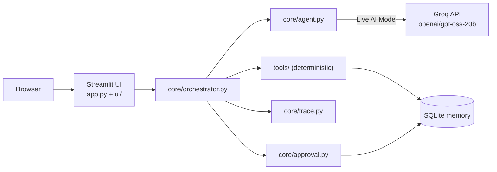

# 🛠️ RootCause Copilot – AI-Powered IT Operations Investigation Platform

**Release v1.1 - Workshop Ready Release.** An educational reference implementation for the *Advanced Hands-on
Workshop on Agentic AI* (Day 4: agentic investigation workflows · Day 5: Docker, Kubernetes, ArgoCD).

> ⚠️ **Simulated, educational environment.** RootCause Copilot does **not** connect to Prometheus, Kubernetes
> clusters, payment systems or any real infrastructure. All incidents, logs and documents are **synthetic**.
> It recommends actions; it **never** executes production changes - approved actions are **simulated**.

RootCause Copilot helps an IT operations engineer answer: *What happened? Which service is affected? What evidence
supports the diagnosis? What is the probable root cause? Have we seen this before? What should we do? What is the
risk? Does it need human approval?*

---

## Contents
[Features](#features) · [Architecture](#architecture) · [Prerequisites](#prerequisites) ·
[Windows installation](#windows-installation-students) · [Groq configuration](#groq-configuration) ·
[Running the application](#running-the-application) · [Demo Mode](#live-ai-mode-and-demo-mode) ·
[Sample incidents](#sample-incident-library) · [Tests](#tests) · [Day 5](#day-5-deployment) ·
[Troubleshooting](#troubleshooting) · [Limitations](#known-limitations) · [Documentation](#documentation-index)

## Features

One central **RootCause Agent** with a controlled, bounded tool workflow - and a **visible execution trace**.

| Capability | What you see | Code |
|---|---|---|
| **Groq-only live AI** | Sidebar *AI Configuration*: masked key, real *Connect / Test connection*, status, fixed model `openai/gpt-oss-20b` | `core/llm_client.py`, `ui/common.py` |
| **Demo Mode** | Works without a key or internet; predefined results labelled **SIMULATED DEMO RESULTS** | `data/demo/`, `core/agent.py` |
| **Execution trace** | Each step: status (Pending / Running / Completed / Failed / Skipped / Awaiting Approval), real timestamp, measured duration, result, **origin** | `core/trace.py` |
| **Deterministic log analysis** | timestamps, ERROR/WARN, exceptions, **stack traces**, repeated errors, services, patterns, **chronological sequence**, suspicious lines with source line numbers | `tools/log_analyzer.py`, `tools/error_pattern_analyzer.py` |
| **Kubernetes analyzer** | Deployment/Service/ConfigMap/Secret/PVC checks with **severity, resource, evidence, recommended correction**; Secret values masked | `tools/kubernetes_analyzer.py` |
| **Persistent incident memory** | SQLite history survives restarts; similar-incident retrieval with source IDs and match reasons; schema migration | `memory/`, `tools/incident_retriever.py` |
| **Knowledge base** | TXT/MD/LOG/PDF upload, metadata, excerpts, **relevance filter** | `tools/document_search.py` |
| **Context management** | ranking, de-duplication, budget, exclusions, three kinds of memory side by side | `core/context_manager.py` |
| **Evidence verification** | max **2** reflection rounds; labels *Strong supporting / Partial supporting / Contradictory / Insufficient evidence* (no invented percentages) | `core/reflection.py` |
| **Human-in-the-loop** | proposed action, reason, evidence, impact, **risk level**, side effects; Approve / Reject / Request more information; audit history; execution simulated | `core/approval.py` |
| **Simulated event trigger** | **Simulate New Incident Alert** starts an investigation (no Prometheus) | `core/event_handler.py` |
| **Reports** | Markdown + PDF with 15 sections incl. mode, trace and generation timestamp | `tools/report_generator.py` |
| **Reliability** | friendly errors, redacted technical log, bounded retries/backoff, contained failures, sanitised filenames | `core/logging_setup.py` |

## Architecture



Seven diagrams (workflow, tool calling, memory, approval, deployment, GitOps): **[ARCHITECTURE.md](ARCHITECTURE.md)**.

| Layer | Technology |
|---|---|
| UI | Streamlit ≥ 1.50 |
| LLM | Groq (only provider), model `openai/gpt-oss-20b`, official `groq` SDK |
| Memory / audit | SQLite (Python standard library) |
| Parsing | regex log analysis, PyYAML `safe_load`, pypdf |
| Reports | Markdown + fpdf2 |
| Deployment | Docker · Kubernetes (Rancher Desktop) · Kustomize · ArgoCD · GitHub |
| Tests | pytest (Groq mocked) |

No Ollama, no local models, no provider/model dropdowns, no vector database, no multi-agent framework.

## Prerequisites

Day 4 needs only **Git for Windows**, **Python 3** (3.12 recommended; 3.11-3.13 should work) and internet access for
Live AI Mode. No Docker, Kubernetes, GPU or local LLM.

## Windows installation (students)

Step-by-step with fixes for every common problem: **[docs/DAY4_HANDS_ON_GUIDE.md](docs/DAY4_HANDS_ON_GUIDE.md)**.
In **PowerShell**:

```powershell
git --version
python --version                       # if not recognised, try:  py --version

git clone <REPOSITORY_URL>             # the instructor shares the URL
cd rootcause-copilot

python -m venv .venv                   # or:  py -3.12 -m venv .venv
.\.venv\Scripts\Activate.ps1           # prompt starts with (.venv)
# blocked?  Set-ExecutionPolicy -Scope Process -ExecutionPolicy Bypass   (this window only), then activate again

python -m pip install --upgrade pip
python -m pip install -r requirements.txt
```

## Groq configuration

1. Create **your own** API key in the Groq console. Usage is subject to your account's limits, rate limits and any
   applicable pricing - free usage is not guaranteed.
2. Start the app, open the **sidebar → AI Configuration**, paste the key, click **🔌 Connect / Test connection**.
   The app makes a real, lightweight request (retrieves the fixed model's metadata - no tokens generated) and shows
   🟢 *Connected* only if Groq accepts the key **and** the model is accessible. Then **Live AI Mode** is selected.
3. Problems are explained in plain words: key rejected · model not accessible · network failure · timeout ·
   rate limit · service error. The key is never shown again in full (`••••••••1234`).
4. **🗑️ Clear API key** removes it. The key lives only in this browser session on the server - never in SQLite,
   logs, reports, files or Git. Optional for deployments: `GROQ_API_KEY` from a Kubernetes Secret.

Optional: **Settings → Run capability check** verifies connection, native tool calling and JSON mode.

## Running the application

```powershell
python -m streamlit run app.py        # opens http://localhost:8501   ·   stop: Ctrl+C
```

Port busy? `python -m streamlit run app.py --server.port 8502`. Leave the virtual environment with `deactivate`.

## Live AI Mode and Demo Mode

| | **Live AI Mode** (primary) | **Demo Mode** (fallback) |
|---|---|---|
| Needs | your Groq key + internet | nothing |
| Tool choice | model decides (native tool calling) | deterministic rules |
| Root-cause hypothesis | generated live (JSON, validated) | **SIMULATED DEMO RESULTS** (predefined) for INC-001..004; rule-based heuristic otherwise |
| Evidence verification | deterministic checks + LLM reviewer | deterministic checks |
| Log / YAML / memory / document analysis | real | **real** |

The app starts in Demo Mode until a key is verified, so nobody is blocked. If live AI fails (invalid key, rate
limit, network), the investigation stops, explains why and **offers** Demo Mode - it never switches silently.
In Demo Mode no AI reasoning is performed; the trace marks every predefined result.

## Sample incident library

| ID | Incident | Symptoms (from synthetic logs) | YAML |
|---|---|---|---|
| INC-001 | Payment service failure | checkout failures, DB timeouts, slow transactions, pool pressure | - |
| INC-002 | Order service failure | downstream timeouts, retries, delayed orders | - |
| INC-003 | Inventory resource pressure | rising memory, restarts, stack traces | ✔ |
| INC-004 | Deployment failure | startup failure, missing config, missing ConfigMap reference | ✔ |
| CHALLENGE-01 | Search service (Day 4 mini challenge) | slow searches, 504s - **no predefined result** | ✔ |

Logs never state the root cause - it must be inferred from evidence. All data is fictional. Expected answers are
kept **outside** this repository (instructor package).

**Typical run:** Knowledge Base → *Load bundled sample documents* → New Investigation → **🚨 Simulate New Incident
Alert** → watch the live trace → explore the tabs (Execution trace, Evidence, Context & memory, Agent actions,
Similar incidents, Diagnosis & evidence, Approval, Close & report, Event log) → approve/reject (simulated) →
close the incident → download the report → restart the app → the incident is still in **Incident History**.

## Tests

```powershell
python -m pip install -r requirements-dev.txt
python -m pytest                                    # offline; Groq is mocked; no key needed
```

Optional live test with your own key (a few small requests):
`$env:GROQ_API_KEY = Read-Host "Groq key"; $env:RUN_LIVE_TESTS = "1"; python -m pytest -m live`
Results of the build verification: [docs/TEST_RESULTS.md](docs/TEST_RESULTS.md).

## Day 5 deployment

- Instructor (macOS + Rancher Desktop + ArgoCD): [docs/DAY5_MAC_INSTRUCTOR_GUIDE.md](docs/DAY5_MAC_INSTRUCTOR_GUIDE.md)
- Students (Windows homework, with low-resource fallback): [docs/DAY5_WINDOWS_DEPLOYMENT_HOMEWORK.md](docs/DAY5_WINDOWS_DEPLOYMENT_HOMEWORK.md)
- Manifests [kubernetes/README.md](kubernetes/README.md) · ArgoCD [argocd/README.md](argocd/README.md) · Docker [docker/README.md](docker/README.md)
- GitOps repository starter: `rootcause-copilot-gitops/` (delivered next to this folder)

## Troubleshooting

[docs/TROUBLESHOOTING.md](docs/TROUBLESHOOTING.md) - Python/PATH, PowerShell policy, Streamlit, Groq errors, uploads,
SQLite, Docker, Kubernetes, Rancher Desktop, ArgoCD. Technical log: `data_store\logs\app.log` (keys redacted).

## Known limitations

- Simulated only: no live monitoring, cluster or payment integration; actions are never executed.
- Regex log analysis is tuned for common Java/Spring/Kubernetes messages; keyword (not semantic) retrieval.
- Static Kubernetes checks cannot prove runtime health.
- SQLite + one replica: not highly available, not multi-writer (PostgreSQL deferred).
- LLM diagnoses can be wrong; reflection reduces but does not eliminate mistakes.
- No authentication/RBAC; the approval button is an educational workflow, not enterprise authorisation.
- Live Groq calls, Docker builds and cluster deployments were not executable in the build environment - see
  [docs/TEST_RESULTS.md](docs/TEST_RESULTS.md).

## Documentation index

| Document | Audience |
|---|---|
| [docs/DAY4_HANDS_ON_GUIDE.md](docs/DAY4_HANDS_ON_GUIDE.md) | Students (Windows) - lab + mini challenge |
| [docs/DAY4_STUDENT_WORKSHEET.md](docs/DAY4_STUDENT_WORKSHEET.md) | Students |
| [docs/HOMEWORK_SUBMISSION.md](docs/HOMEWORK_SUBMISSION.md) | Students (Day 4 challenge + Day 5) |
| [docs/DAY5_WINDOWS_DEPLOYMENT_HOMEWORK.md](docs/DAY5_WINDOWS_DEPLOYMENT_HOMEWORK.md) | Students (Windows) |
| [docs/DAY5_MAC_INSTRUCTOR_GUIDE.md](docs/DAY5_MAC_INSTRUCTOR_GUIDE.md) | Instructor (macOS) |
| [docs/TROUBLESHOOTING.md](docs/TROUBLESHOOTING.md) | Everyone |
| [ARCHITECTURE.md](ARCHITECTURE.md) | Everyone |
| [SECURITY.md](SECURITY.md) | Everyone |
| [RELEASE_NOTES.md](RELEASE_NOTES.md) | Everyone |
| [docs/TEST_RESULTS.md](docs/TEST_RESULTS.md) | Build verification record |

Instructor-only material (answer key, instructor notes, demo script) is delivered **separately** in the package
folder `instructor/` and is intentionally not part of this repository.
