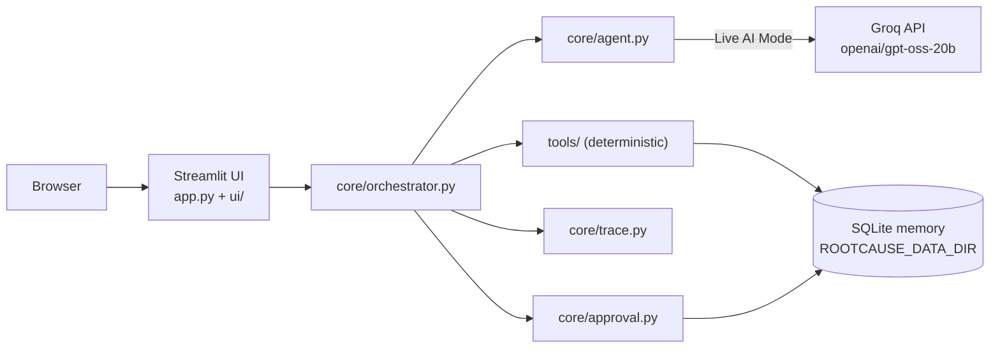
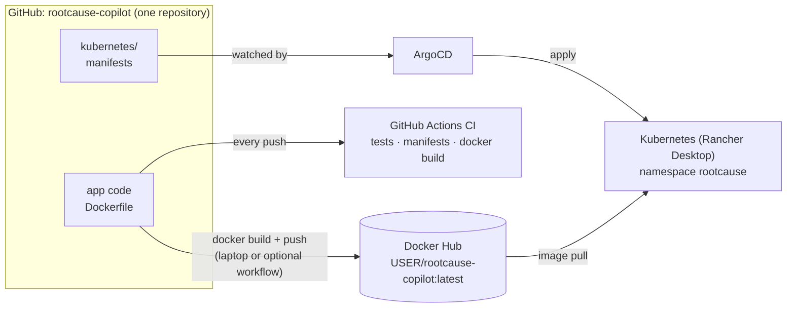
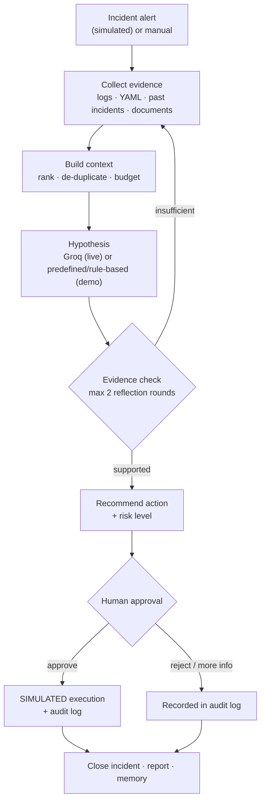
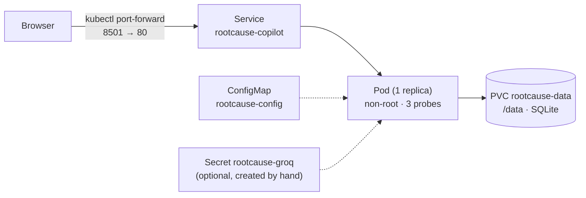
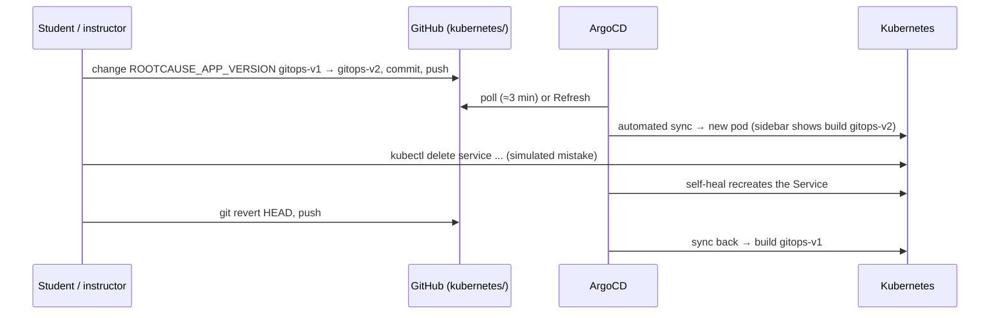

# 🛠️ RootCause Copilot – AI-Powered IT Operations Investigation Platform

**Release v1.1 · Day 5 deployment-ready.** The reference application of the *Six-Day Advanced Hands-on Workshop on
Agentic AI*: **Day 4** builds and explores an agentic investigation workflow; **Day 5** takes the *same* application
from a laptop to **Docker → Docker Hub → Kubernetes (Rancher Desktop) → ArgoCD GitOps**.

> ⚠️ **Simulated, educational environment.** RootCause Copilot does **not** connect to Prometheus, a real
> Kubernetes cluster, a payment system or any production infrastructure. All incidents, logs and documents are
> **synthetic**. It recommends actions; it **never** executes them - approved actions are **simulated**.

**Step-by-step guides:** 🪟 **[README_WINDOWS.md](README_WINDOWS.md)** (students, PowerShell) ·
🍎 **[README_MAC.md](README_MAC.md)** (instructor demo, zsh, Apple Silicon + Intel).
This page is the overview: *what* the project is and *how the pieces fit*.

---

## Contents

1. [The industry problem](#1-the-industry-problem) · 2. [Objectives and learning outcomes](#2-objectives-and-learning-outcomes) ·
3. [Features](#3-features) · 4. [Architecture](#4-architecture) · 5. [Agent workflow](#5-agent-workflow) ·
6. [Tech stack](#6-tech-stack) · 7. [Repository structure](#7-repository-structure) · 8. [Screenshots](#8-screenshots) ·
9. [Quick start](#9-quick-start) · 10. [Docker](#10-docker-overview) · 11. [Kubernetes](#11-kubernetes-overview) ·
12. [ArgoCD GitOps](#12-argocd-gitops-overview) · 13. [Platform guides](#13-platform-guides) ·
14. [Tests and CI](#14-tests-and-ci) · 15. [Troubleshooting](#15-troubleshooting) ·
16. [Limitations and security](#16-limitations-and-security) · 17. [Homework](#17-homework) ·
[Documentation index](#documentation-index)

## 1. The industry problem

When a production service fails, an on-call engineer has minutes to answer: *What happened? Which service is
affected? What evidence supports the diagnosis? Have we seen this before? What should we do, how risky is it, and
does it need a human to approve it?* The evidence is scattered over logs, Kubernetes YAML, runbooks and past
incident tickets. Real outages (for example the July 2024 CrowdStrike/Microsoft Windows incident) show how much the
*speed and quality of the investigation* matter.

RootCause Copilot shows how an **agentic AI** assistant can gather that evidence with tools, keep a memory of past
incidents, check its own conclusion, and stop at a **human approval gate** - and how such an application is
packaged and operated with modern DevOps practice.

## 2. Objectives and learning outcomes

| After Day 4 you can… | After Day 5 you can… |
|---|---|
| explain the agent loop *observe → plan → act with tools → reflect → ask a human* | build a secure, non-root **Docker image** and run it with a persistent volume |
| read an **execution trace** and tell AI reasoning from deterministic tool output | publish the image to **Docker Hub** with the `latest` convention |
| use persistent incident memory and a knowledge base as agent context | deploy to **Kubernetes** with a Namespace, ConfigMap, Secret, PVC, Deployment and Service |
| justify a root cause with evidence and rule out alternatives | let **ArgoCD** keep the cluster equal to Git: sync, self-heal, roll back with `git revert` |
| explain why risky actions need human approval | explain *why* one replica, `Recreate`, probes, a PVC and no committed secrets |

## 3. Features

One central **RootCause Agent** with a controlled, bounded tool workflow and a **visible execution trace**.

| Capability | What you see | Status | Code |
|---|---|---|---|
| **Groq live AI** | Sidebar *AI Configuration*: masked key, real *Connect / Test connection*, fixed model `openai/gpt-oss-20b` | ✅ implemented | `core/llm_client.py`, `ui/common.py` |
| **Demo Mode** | Works without a key or internet; predefined results labelled **SIMULATED DEMO RESULTS** | ✅ implemented (results are predefined) | `data/demo/`, `core/agent.py` |
| **Execution trace** | Each step: status, real timestamp, measured duration, result, **origin** (AI / tool / demo) | ✅ implemented | `core/trace.py` |
| **Log analysis** | errors, exceptions, stack traces, repeated errors, services, chronological sequence, suspicious lines with line numbers | ✅ implemented (deterministic regex) | `tools/log_analyzer.py`, `tools/error_pattern_analyzer.py` |
| **Kubernetes YAML analyzer** | 27 check types with severity, evidence and recommended correction; Secret values masked | ✅ implemented (static checks only) | `tools/kubernetes_analyzer.py` |
| **Persistent incident memory** | SQLite history survives restarts; similar-incident retrieval with match reasons | ✅ implemented (keyword, not semantic) | `memory/`, `tools/incident_retriever.py` |
| **Knowledge base** | TXT/MD/LOG/PDF upload, excerpts, relevance filter | ✅ implemented | `tools/document_search.py` |
| **Evidence verification** | max **2** reflection rounds; *Strong / Partial supporting / Contradictory / Insufficient evidence* | ✅ implemented | `core/reflection.py` |
| **Human-in-the-loop** | proposed action, risk level, side effects; Approve / Reject / Request more information; audit history | ✅ workflow implemented · ⚠️ **execution simulated** | `core/approval.py` |
| **Incident alert** | **🚨 Simulate New Incident Alert** button | ⚠️ **simulated** (no Prometheus / webhook) | `core/event_handler.py` |
| **Reports** | Markdown + PDF, 15 sections incl. mode and trace | ✅ implemented | `tools/report_generator.py` |
| **Container + Kubernetes + GitOps** | Dockerfile, Kustomize manifests, ArgoCD Application, GitHub Actions CI | ✅ implemented (deploys the app itself; the app never changes a cluster) | `Dockerfile`, `kubernetes/`, `argocd/`, `.github/` |

**Live AI Mode vs Demo Mode**

| | **Live AI Mode** (primary) | **Demo Mode** (fallback) |
|---|---|---|
| Needs | your Groq key + internet | nothing |
| Tool choice | the model decides (native tool calling) | deterministic rules |
| Root-cause hypothesis | generated live (JSON, validated) | **SIMULATED DEMO RESULTS** for INC-001…004; rule-based heuristic otherwise |
| Log / YAML / memory / document analysis | real | **real** |

The app starts in Demo Mode until a key is verified. If live AI fails (invalid key, rate limit, network) the
investigation stops, explains why and **offers** Demo Mode - it never switches silently.

**Sample incident library** (all fictional; logs never state the root cause):
INC-001 payment service failure · INC-002 order service failure · INC-003 inventory resource pressure (YAML) ·
INC-004 deployment failure (YAML) · **CHALLENGE-01** search service - the Day 4 mini challenge, *no predefined answer*.

## 4. Architecture



**Delivery architecture (Day 5) - one repository, two jobs:**



> **Source code vs image.** GitHub stores the *source* and the *desired state* (YAML). Docker Hub stores the *built
> image*. ArgoCD never builds anything - it applies the YAML in `kubernetes/`, and Kubernetes pulls the image named
> in that YAML from Docker Hub.

Seven more diagrams (tool calling, memory, approval, deployment, GitOps): **[ARCHITECTURE.md](ARCHITECTURE.md)**.

## 5. Agent workflow



## 6. Tech stack

| Layer | Technology |
|---|---|
| UI | Streamlit ≥ 1.50 |
| LLM | Groq (only provider), model `openai/gpt-oss-20b`, official `groq` SDK |
| Memory / audit | SQLite (Python standard library) |
| Parsing / reports | regex log analysis, PyYAML `safe_load`, pypdf · Markdown + fpdf2 |
| Container | Docker, `python:3.12-slim`, non-root user 10001 |
| Orchestration | Kubernetes (Rancher Desktop / k3s), Kustomize |
| GitOps | ArgoCD (automated sync + self-heal, conservative pruning) |
| CI | GitHub Actions: pytest, Streamlit smoke test, kubeconform, Docker build + runtime test |
| Tests | pytest (Groq mocked) |

No Ollama, no local models, no vector database, no multi-agent framework.

## 7. Repository structure

```text
rootcause-copilot/
├── README.md               ← this overview
├── README_WINDOWS.md       ← student guide, PowerShell, step by step
├── README_MAC.md           ← instructor demo guide, zsh, Apple Silicon / Intel
├── app.py · config.py      ← Streamlit entry point · settings (env vars)
├── core/ memory/ tools/ ui/   ← agent, SQLite memory, deterministic tools, pages
├── data/                   ← synthetic logs, YAML, documents, scenarios, demo results
├── Dockerfile · .dockerignore · .env.example
├── docker/README.md        ← short Docker reference
├── kubernetes/             ← namespace, configmap, pvc, deployment, service, kustomization (+ secret template)
├── argocd/                 ← rootcause-copilot-application.yaml
├── .github/workflows/      ← ci.yml (every push) · docker-publish.yml (optional, manual)
├── docs/                   ← deployment deep dives, troubleshooting, homework, test results
├── tests/                  ← pytest suite (offline, Groq mocked)
└── ARCHITECTURE.md · SECURITY.md · RELEASE_NOTES.md
```

## 8. Screenshots

The repository does not ship screenshots, because they go out of date quickly and may show credentials. During the
Day 5 demo, capture these yourself; they are the evidence for the homework:

| # | Screenshot |
|---|---|
| 1 | App in the browser (sidebar shows `Release v1.1 · build …`) |
| 2 | `docker ps` showing `rootcause` as `(healthy)` |
| 3 | Your image on hub.docker.com |
| 4 | `kubectl -n rootcause get pods,svc,pvc` (pod `Running`, PVC `Bound`) |
| 5 | ArgoCD tile **Synced** + **Healthy**, and the resource tree |

## 9. Quick start

Python 3.11-3.13 (3.12 recommended) and Git. Full, explained steps per platform: [Windows](README_WINDOWS.md#c-run-the-application-locally) ·
[macOS](README_MAC.md#c-run-the-application-locally).

```bash
git clone https://github.com/appars/rootcause-copilot.git
cd rootcause-copilot
python -m venv .venv
# Windows:  .\.venv\Scripts\Activate.ps1        macOS/Linux:  source .venv/bin/activate
python -m pip install -r requirements.txt
python -m streamlit run app.py          # http://localhost:8501  ·  stop with Ctrl+C
```

No key? The app runs in **Demo Mode**. For Live AI Mode create your own key in the Groq console and paste it in
**sidebar → AI Configuration → Connect / Test connection**. The key stays in the browser session only - never in
SQLite, logs, reports, files or Git. (Groq usage is subject to your account's limits; free usage is not guaranteed.)

## 10. Docker overview

A Docker image is the application *plus* its Python runtime and libraries, packed into one portable unit - like a
sealed lunchbox: what you packed at home is exactly what you open at college. Details: [docs/DOCKER_DEPLOYMENT.md](docs/DOCKER_DEPLOYMENT.md).

```bash
docker build -t DOCKERHUB_USERNAME/rootcause-copilot:latest .
docker run -d --name rootcause -p 8501:8501 -v rootcause-data:/data DOCKERHUB_USERNAME/rootcause-copilot:latest
docker ps                    # STATUS shows (healthy) after ~30 s
docker push DOCKERHUB_USERNAME/rootcause-copilot:latest     # after docker login
```

| Design decision | Why |
|---|---|
| `python:3.12-slim`, runtime dependencies only | small image, fewer vulnerabilities |
| non-root user `10001`, owns only `/data` | a compromised app cannot modify the image |
| binds `0.0.0.0:8501`, `HEALTHCHECK` on `/_stcore/health` | reachable from outside the container; Docker knows when it is ready |
| SQLite at `/data` + volume `rootcause-data` | incident memory survives container re-creation |
| no key, `.env` or database in the image (`.dockerignore`) | an image is easy to share - it must contain no secrets |
| one tag, `latest`, for this course | simple to teach; `docs/DOCKER_DEPLOYMENT.md` explains when to use versioned tags |

## 11. Kubernetes overview

Kubernetes keeps the container running, restarts it when it fails, gives it storage and a stable network name.
Details: [docs/KUBERNETES_DEPLOYMENT.md](docs/KUBERNETES_DEPLOYMENT.md) · manifest reference: [kubernetes/README.md](kubernetes/README.md).



```bash
kubectl kustomize kubernetes/        # preview
kubectl apply -k kubernetes/         # deploy (manual path)
kubectl -n rootcause get pods,svc,pvc
kubectl -n rootcause port-forward svc/rootcause-copilot 8501:80
```

**Exactly one replica + `Recreate`:** SQLite on one `ReadWriteOnce` volume is a single-writer database. Two pods
would compete for the same file (CodeForge Agents, which is stateless, can run two; RootCause Copilot cannot).

## 12. ArgoCD GitOps overview

**GitOps = Git is the single source of truth for what runs in the cluster.** ArgoCD watches the `kubernetes/`
folder of *this* repository (`main` branch) and keeps namespace `rootcause` equal to it. Details:
[docs/ARGOCD_GITOPS.md](docs/ARGOCD_GITOPS.md).



| Setting | Value | Why |
|---|---|---|
| `repoURL` / `path` / `targetRevision` | this repo / `kubernetes` / `main` | one repository, no separate GitOps repo |
| `automated.selfHeal` | `true` | manual cluster changes are reverted |
| `automated.prune` | `false` | conservative - nothing is deleted automatically |
| PVC + Namespace | `Prune=false,Delete=false` | student incident memory is never deleted by ArgoCD |
| new `:latest` image | `kubectl rollout restart` (or ArgoCD *Restart*) | an unchanged tag is not a Git change |

## 13. Platform guides

| Guide | Who | Shell | Covers |
|---|---|---|---|
| **[README_WINDOWS.md](README_WINDOWS.md)** | students | PowerShell | prerequisites → local run → Docker → Docker Hub → Kubernetes → ArgoCD → checklist → Windows fixes |
| **[README_MAC.md](README_MAC.md)** | instructor (and Mac students) | zsh | same flow, Apple Silicon (arm64) and Intel notes, multi-platform images |

## 14. Tests and CI

```bash
python -m pip install -r requirements-dev.txt
python -m pytest                     # offline; Groq is mocked; no key needed
```

Optional live test with your own key: set `GROQ_API_KEY` and `RUN_LIVE_TESTS=1`, then `python -m pytest -m live`.

**GitHub Actions** (`.github/workflows/ci.yml`, every push / pull request, no secrets needed): tests on Python 3.11
and 3.12 · a real headless start of the app · `kubectl kustomize` + kubeconform for the manifests and the ArgoCD
Application · `docker build`, health check, non-root and persistence checks. It **never pushes** an image.
`docker-publish.yml` is an optional, manual-only workflow that pushes `latest` (amd64 + arm64) once you add the
`DOCKERHUB_USERNAME` / `DOCKERHUB_TOKEN` repository secrets. Verification record: [docs/TEST_RESULTS.md](docs/TEST_RESULTS.md).

## 15. Troubleshooting

[docs/TROUBLESHOOTING.md](docs/TROUBLESHOOTING.md) covers Python/PATH, PowerShell policy, Streamlit, Groq errors,
uploads, SQLite, Docker, Docker Hub, Rancher Desktop, Kubernetes and ArgoCD. The platform guides end with the
Windows- and macOS-specific problems. Technical log: `data_store/logs/app.log` locally, `/data/logs/app.log` in a
container (keys redacted).

## 16. Limitations and security

- **Simulated:** no monitoring integration, no real cluster or payment access; approved actions are never executed.
- Regex log analysis and keyword retrieval can miss evidence; static YAML checks cannot prove runtime health.
- SQLite + one replica: not highly available, not multi-writer (PostgreSQL deliberately deferred).
- LLM diagnoses can be wrong; reflection reduces but does not eliminate mistakes.
- **No authentication or RBAC** - run locally or on a trusted network only; access is through `kubectl port-forward`.
- The `latest` tag is a teaching simplification: you cannot tell from Git *which* build is running.
- Secrets: never commit a Groq key, Docker Hub token, kubeconfig or Secret YAML. Base64 in a Secret is **encoding,
  not encryption**. Full model: [SECURITY.md](SECURITY.md).

## 17. Homework

Part A (Day 4 challenge, CHALLENGE-01) and Part B (Day 5: Docker, Docker Hub, Kubernetes, ArgoCD, with a
low-resource fallback path): **[docs/HOMEWORK_SUBMISSION.md](docs/HOMEWORK_SUBMISSION.md)**. Follow
[README_WINDOWS.md](README_WINDOWS.md) section by section and tick its verification checklist.

## Documentation index

| Document | Audience |
|---|---|
| [README_WINDOWS.md](README_WINDOWS.md) · [README_MAC.md](README_MAC.md) | step-by-step guides |
| [docs/DAY4_HANDS_ON_GUIDE.md](docs/DAY4_HANDS_ON_GUIDE.md) · [docs/DAY4_STUDENT_WORKSHEET.md](docs/DAY4_STUDENT_WORKSHEET.md) | Day 4 lab |
| [docs/DOCKER_DEPLOYMENT.md](docs/DOCKER_DEPLOYMENT.md) | Docker concepts and reference |
| [docs/KUBERNETES_DEPLOYMENT.md](docs/KUBERNETES_DEPLOYMENT.md) | Kubernetes concepts and reference |
| [docs/ARGOCD_GITOPS.md](docs/ARGOCD_GITOPS.md) | GitOps concepts and reference |
| [docs/HOMEWORK_SUBMISSION.md](docs/HOMEWORK_SUBMISSION.md) | students |
| [docs/TROUBLESHOOTING.md](docs/TROUBLESHOOTING.md) | everyone |
| [docs/TEST_RESULTS.md](docs/TEST_RESULTS.md) | build verification record |
| [ARCHITECTURE.md](ARCHITECTURE.md) · [SECURITY.md](SECURITY.md) · [RELEASE_NOTES.md](RELEASE_NOTES.md) | everyone |

Instructor-only material (answer key, notes, demo script) is delivered **separately** and is intentionally not part
of this repository.
