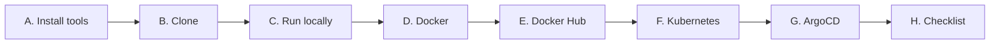
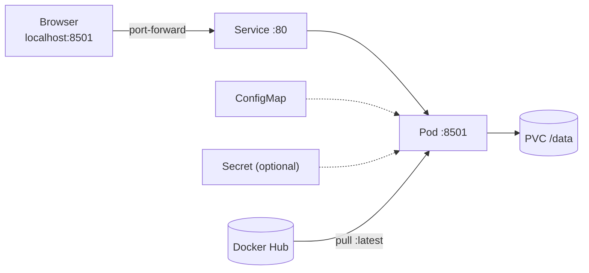

# 🪟 RootCause Copilot on Windows - Local → Docker → Docker Hub → Kubernetes → ArgoCD

The student guide for Day 5 and the homework. Every command is **PowerShell** (Windows 10 22H2 or Windows 11).
Work through sections **A → I** in order; each step explains *what*, *why*, the command, the expected output and how
to verify it. Overview of the project: [README.md](README.md) · macOS version: [README_MAC.md](README_MAC.md).

> 🔐 **Placeholders.** `DOCKERHUB_USERNAME` means *your* Docker Hub username (lowercase). `<your-github-user>` means
> your GitHub username. Never type an API key, token or password into a file that goes to Git, and never show one
> on a screenshot.



| Section | You need | Time (first time) |
|---|---|---|
| A-C | Git, Python | 20-30 min |
| D-E | + Rancher Desktop (or Docker Desktop), Docker Hub account | 30-40 min |
| F | + Kubernetes enabled (8 GB RAM minimum, 16 GB comfortable) | 30 min |
| G | + ArgoCD | 30 min |

Low-resource laptop? Do A-E, then follow the **fallback path** in [docs/HOMEWORK_SUBMISSION.md](docs/HOMEWORK_SUBMISSION.md).

---

## A. Prerequisites

### A1. Tools

| Tool | Needed for | Mandatory? | Install (PowerShell) | Verify |
|---|---|---|---|---|
| **Git for Windows** | clone, commit, push | ✅ mandatory | `winget install -e --id Git.Git` | `git --version` |
| **Python 3.12** (3.11-3.13 work) | running locally (C) | ✅ mandatory | `winget install -e --id Python.Python.3.12` | `python --version` (or `py --version`) |
| **Rancher Desktop** *or* Docker Desktop | Docker (D-E), Kubernetes (F-G) | ✅ mandatory from D | `winget install -e --id SUSE.RancherDesktop` | `docker version` |
| **kubectl** | Kubernetes (F-G) | ✅ mandatory from F (Rancher Desktop already includes it) | `winget install -e --id Kubernetes.kubectl` | `kubectl version --client` |
| **ArgoCD CLI** | optional command-line control of ArgoCD | ⚪ optional (the web UI is enough) | `winget install -e --id argoproj.argocd` | `argocd version --client` |
| **VS Code** | editing YAML comfortably | ⚪ optional (Notepad works) | `winget install -e --id Microsoft.VisualStudioCode` | `code --version` |

> After installing anything, **close and reopen PowerShell** - new programs are only found by new windows (PATH).
> No `winget`? Install *App Installer* from the Microsoft Store, or download the installers from the vendors' sites.

### A2. Rancher Desktop or Docker Desktop?

Both give you a Docker engine **and** a single-node Kubernetes cluster inside a small Linux VM (WSL 2).

| | **Rancher Desktop** (workshop default) | **Docker Desktop** |
|---|---|---|
| Licence | free and open source | free for education / personal / small business; paid subscription for larger companies |
| Kubernetes | k3s, one checkbox, version selectable | kind or kubeadm, one checkbox |
| Includes | `docker` (or `nerdctl`), `kubectl`, `helm` | `docker`, `kubectl` |
| kubectl context name | `rancher-desktop` | `docker-desktop` |
| Default storage class (for the PVC) | `local-path` | `hostpath` (kubeadm) / `standard` (kind) |

**Use one, not both** - two engines fight over the same ports and the `docker` command.

**Rancher Desktop settings** (*Preferences*):

1. **Container Engine → `dockerd (moby)`.** This gives you the normal `docker` command used in this guide.
   (`containerd` uses `nerdctl` instead of `docker`; this guide assumes `dockerd`.)
2. **Kubernetes → Enable Kubernetes ✅**, pick a recent stable version. Wait until the status bar shows Kubernetes
   as *running* (first start: several minutes).
3. **Virtual Machine → Memory:** at least 4 GB (6 GB if ArgoCD is installed too).

**Docker Desktop instead:** *Settings → Kubernetes → Enable Kubernetes → Apply & restart*; then use the context
`docker-desktop` wherever this guide says `rancher-desktop`.

Both need **WSL 2** and hardware virtualization: if the installer complains, run `wsl --install` in an
*Administrator* PowerShell, reboot, and enable virtualization (Intel VT-x / AMD-V) in the BIOS if needed.

### A3. Accounts

| Account | Needed for | Mandatory? |
|---|---|---|
| GitHub | fork + push (G) | ✅ for G |
| Docker Hub (free) | publishing the image (E) | ✅ for E-G |
| Groq console | Live AI Mode | ⚪ optional - Demo Mode needs no key |

---

## B. Clone the repository

**Why fork first?** In section G, ArgoCD must watch a repository *you* can push to. A fork is your own copy on GitHub.

1. Open https://github.com/appars/rootcause-copilot and click **Fork** (keep the name `rootcause-copilot`).
2. Clone your fork:

```powershell
cd $HOME\Documents
git clone https://github.com/<your-github-user>/rootcause-copilot.git
cd rootcause-copilot
git log --oneline -3          # expected: the latest commits, no error
```

Already cloned the course repository? Point it at your fork instead of cloning again:
`git remote set-url origin https://github.com/<your-github-user>/rootcause-copilot.git` then `git remote -v`.

---

## C. Run the application locally

**What:** the plain Python way - the reference you will compare the container against.

```powershell
python -m venv .venv                         # or:  py -3.12 -m venv .venv
.\.venv\Scripts\Activate.ps1                 # the prompt now starts with (.venv)
```

Activation blocked ("running scripts is disabled")? Allow it **for this window only**, then activate again:
`Set-ExecutionPolicy -Scope Process -ExecutionPolicy Bypass`

```powershell
python -m pip install --upgrade pip
python -m pip install -r requirements.txt     # 1-3 min; ends with "Successfully installed ..."
python -m streamlit run app.py                # browser opens http://localhost:8501
```

**Configuration.** No configuration file is needed. Optional settings are environment variables (see
[.env.example](.env.example)): `ROOTCAUSE_DATA_DIR` (default `.\data_store`), `ROOTCAUSE_MAX_UPLOAD_BYTES`.

**Groq key (optional).** In the app: **sidebar → AI Configuration** → paste your key → **🔌 Connect / Test
connection** → 🟢 *Connected* → Live AI Mode. The key lives only in this browser session - never in a file or Git.

**Demo Mode.** Without a key the app runs in **Demo Mode**: analysis tools are real, the AI conclusions are
predefined and clearly labelled **SIMULATED DEMO RESULTS**.

**Verify:**

1. Sidebar shows `Release v1.1 · build local`.
2. **New Investigation → 🚨 Simulate New Incident Alert** → the trace runs → a result appears.
3. Stop the app (**Ctrl+C**), start it again → **Incident History** still lists the incident (SQLite in `data_store\`).

Port 8501 busy? `python -m streamlit run app.py --server.port 8502`. Leave the venv with `deactivate`.

---

## D. Docker

### D1. The idea

> **Analogy:** the virtual environment is *your kitchen* - it works on your laptop. A **Docker image** is a
> *sealed lunchbox*: the app, Python and every library packed together, so it runs the same on any machine.
> A **container** is the lunchbox opened and running. A **volume** is a *locker* outside the lunchbox where the
> incident memory is kept, so throwing away the lunchbox does not lose your data.

### D2. Read the Dockerfile (2 minutes)

| Line | Meaning |
|---|---|
| `FROM ${PYTHON_IMAGE}` (default `python:3.12-slim`) | start from an official, small Python image |
| `RUN pip install -r requirements.txt` | install libraries (copied first, so this layer is cached) |
| `COPY . .` | add the source code (`.dockerignore` keeps out `.env`, `.venv`, databases, tests, `.git`) |
| `USER 10001` | run as a normal user, never as root |
| `ENV ROOTCAUSE_DATA_DIR=/data`, `VOLUME ["/data"]` | SQLite is written to `/data` |
| `EXPOSE 8501`, `--server.address=0.0.0.0` | listen on all interfaces so `-p` port publishing works |
| `HEALTHCHECK … /_stcore/health` | Docker reports the container as `healthy` / `unhealthy` |

### D3. Build

Make sure Rancher Desktop is running, then from the repository folder:

```powershell
$DOCKERHUB_USERNAME = "yourdockerhubname"        # lowercase, your real Docker Hub username
docker version                                   # both Client and Server sections must appear
docker build -t "$DOCKERHUB_USERNAME/rootcause-copilot:latest" .
docker image ls "$DOCKERHUB_USERNAME/rootcause-copilot"
```

Expected: the build ends with `naming to docker.io/<you>/rootcause-copilot:latest`; the image is several hundred MB (mostly Python libraries).
The first build downloads the base image (a few minutes); later builds reuse cached layers.

### D4. Run, ports, logs, health

```powershell
docker run -d --name rootcause -p 8501:8501 -v rootcause-data:/data "$DOCKERHUB_USERNAME/rootcause-copilot:latest"
docker ps                                                     # STATUS: Up … (health: starting) → (healthy)
docker logs -f rootcause                                      # "You can now view your Streamlit app…"  (Ctrl+C stops following)
docker inspect --format "{{.State.Health.Status}}" rootcause # healthy
curl.exe http://localhost:8501/_stcore/health                # ok
```

| Flag | Meaning |
|---|---|
| `-d` | run in the background |
| `--name rootcause` | a name you can use instead of the container ID |
| `-p 8501:8501` | **laptop port : container port** - open http://localhost:8501 |
| `-v rootcause-data:/data` | named volume (the "locker") mounted where the app writes SQLite |

> Use `curl.exe`, not `curl`: in Windows PowerShell `curl` is an alias for `Invoke-WebRequest`.
> If the Streamlit app from section C is still running on 8501, stop it first or use `-p 8502:8501`.

**Live AI Mode in the container:** paste the key in the sidebar as before - or pass it from an environment
variable without writing it on the command line:

```powershell
$env:GROQ_API_KEY = Read-Host "Paste your Groq API key"      # only in this window
docker rm -f rootcause
docker run -d --name rootcause -p 8501:8501 -v rootcause-data:/data -e GROQ_API_KEY "$DOCKERHUB_USERNAME/rootcause-copilot:latest"
Remove-Item Env:\GROQ_API_KEY
```

(`-e GROQ_API_KEY` without `=value` copies the variable from your window into the container.)

### D5. Prove that the volume keeps your data

```powershell
# 1. In the browser: simulate an incident alert and note its ID (e.g. INC-1001).
docker rm -f rootcause                          # delete the container completely
docker run -d --name rootcause -p 8501:8501 -v rootcause-data:/data "$DOCKERHUB_USERNAME/rootcause-copilot:latest"
# 2. Reload the browser → Incident History still shows the incident.
docker volume inspect rootcause-data            # where Docker keeps the locker
```

### D6. Stop and clean up

```powershell
docker stop rootcause               # stop (keeps the container)
docker start rootcause              # start again
docker rm -f rootcause              # remove the container
docker volume rm rootcause-data     # ⚠ deletes the incident memory - only when you really want a fresh start
```

More background: [docs/DOCKER_DEPLOYMENT.md](docs/DOCKER_DEPLOYMENT.md).

---

## E. Publish the image to Docker Hub

**Why:** Kubernetes (and your classmates) cannot see images on your laptop's Docker - they pull from a
**registry**. The course convention is **`DOCKERHUB_USERNAME/rootcause-copilot:latest`**.

1. **Account:** sign up at https://hub.docker.com (free). Your username is the first part of every image name.
2. **Repository:** *Repositories → Create repository* → name **`rootcause-copilot`**, visibility **Public**
   (Kubernetes pulls it without credentials). Pushing also creates it automatically, but private by default on
   some accounts - create it yourself to be sure.
3. **Access token instead of password:** *Account settings → Personal access tokens → Generate new token*,
   permission **Read & Write**. Copy it once; it is shown only one time.
4. **Login** - type the username, then paste the token at the *Password* prompt (it is not echoed, not stored in
   your history):

```powershell
docker login -u $DOCKERHUB_USERNAME          # expected: Login Succeeded
```

5. **Build, tag, push:**

```powershell
docker build -t "$DOCKERHUB_USERNAME/rootcause-copilot:latest" .     # skip if built in D3 and unchanged
# Built with another name earlier? Give the same image the Docker Hub name:
#   docker tag rootcause-copilot:local "$DOCKERHUB_USERNAME/rootcause-copilot:latest"
docker push "$DOCKERHUB_USERNAME/rootcause-copilot:latest"            # layers upload, ends with latest: digest: sha256:…
```

6. **Verify:** open `https://hub.docker.com/r/<your-username>/rootcause-copilot` - the tag `latest` and its
   architecture (`linux/amd64` on a normal Windows PC) are listed. Prove it really comes from the registry:

```powershell
docker rm -f rootcause
docker image rm "$DOCKERHUB_USERNAME/rootcause-copilot:latest"
docker pull "$DOCKERHUB_USERNAME/rootcause-copilot:latest"
```

**Updating later:** change code → `docker build` → `docker push` (same `latest` tag) → in Kubernetes run
`kubectl -n rootcause rollout restart deployment/rootcause-copilot` (section F7).

---

## F. Kubernetes on Rancher Desktop

### F1. Concepts in one table

| Object | Plain words | In this project |
|---|---|---|
| **Namespace** | a folder for resources | `rootcause` |
| **Pod** | one running copy of the container | created by the Deployment |
| **Deployment** | "keep 1 pod of this image running, replace it if it dies" | `rootcause-copilot`, 1 replica, `Recreate` |
| **Service** | a stable name + port in front of the pod | `rootcause-copilot`, port 80 → 8501 |
| **ConfigMap** | non-secret settings | `rootcause-config` (`ROOTCAUSE_DATA_DIR=/data`) |
| **Secret** | sensitive settings (base64-**encoded**, not encrypted) | `rootcause-groq` - optional, created by hand, never in Git |
| **PVC** | a request for persistent disk | `rootcause-data`, 1 Gi, mounted at `/data` |
| **Kustomize** | builds the final YAML from a list of files | `kubernetes/kustomization.yaml` |



### F2. Check the cluster and select the right context

```powershell
kubectl config get-contexts                       # * marks the current one
kubectl config use-context rancher-desktop        # Docker Desktop: docker-desktop
kubectl get nodes                                 # expected: 1 node, STATUS Ready
kubectl get storageclass                          # expected: local-path (default)
```

### F3. Put your image name into the Deployment (one line)

Open `kubernetes\deployment.yaml` (VS Code or `notepad kubernetes\deployment.yaml`) and change the line under
`>>> EDIT THIS LINE` from `docker.io/DOCKERHUB_USERNAME/rootcause-copilot:latest` to
`docker.io/<your-username>/rootcause-copilot:latest`. Or with one command:

```powershell
(Get-Content kubernetes\deployment.yaml) -replace 'DOCKERHUB_USERNAME', $DOCKERHUB_USERNAME | Set-Content kubernetes\deployment.yaml
Select-String -Path kubernetes\deployment.yaml -Pattern "image:"      # shows your username
```

### F4. Preview, then apply

```powershell
kubectl kustomize kubernetes\           # prints Namespace, ConfigMap, PVC, Deployment, Service - nothing is changed yet
kubectl apply -k kubernetes\            # creates them
```

Expected:
```text
namespace/rootcause created
configmap/rootcause-config created
persistentvolumeclaim/rootcause-data created
service/rootcause-copilot created
deployment.apps/rootcause-copilot created
```

### F5. Optional: give the pod your Groq key through a Secret

Not needed for Demo Mode, and you can always paste the key in the sidebar instead. Create the Secret with
`kubectl` so the key never touches a file (`Read-Host` also keeps it out of your PowerShell history):

```powershell
$secure = Read-Host "Paste your Groq API key" -AsSecureString
$key = [System.Net.NetworkCredential]::new("", $secure).Password
kubectl -n rootcause create secret generic rootcause-groq --from-literal=GROQ_API_KEY=$key
Remove-Variable key, secure
kubectl -n rootcause rollout restart deployment/rootcause-copilot     # pods read env vars only at start
kubectl -n rootcause get secret rootcause-groq                       # TYPE Opaque, DATA 1 - never print the value
```

> **Base64 is not encryption.** Anyone allowed to read Secrets in the namespace can decode the key in one command.
> That is why Secrets are never committed to Git - not even as a "base64 YAML". Replace (rotate) a key that leaked.

### F6. Inspect and open the app

```powershell
kubectl -n rootcause get pods,deployments,services,pvc
kubectl -n rootcause get pods -w                   # watch: ContainerCreating → Running, READY 1/1 (Ctrl+C to stop)
kubectl -n rootcause describe pod -l app=rootcause-copilot   # Events at the bottom explain any problem
kubectl -n rootcause logs deploy/rootcause-copilot
kubectl -n rootcause port-forward svc/rootcause-copilot 8501:80
```

Keep the port-forward window open and browse to http://localhost:8501 (stop the Docker container from D first,
or use `8502:80`). Expected: pod `Running 1/1`, PVC `Bound`, Service `ClusterIP` port `80/TCP`, sidebar shows
`build gitops-v1`.

**Persistence check:** simulate an incident, then delete the pod - the Deployment creates a new one with the same PVC:

```powershell
kubectl -n rootcause delete pod -l app=rootcause-copilot
kubectl -n rootcause get pods -w              # new pod Running → restart the port-forward → incident still listed
```

### F7. Picking up a new `:latest` image

The YAML does not change when you push a new `latest`, so tell Kubernetes to start a fresh pod.
`imagePullPolicy: Always` makes it pull the newest image:

```powershell
kubectl -n rootcause rollout restart deployment/rootcause-copilot
kubectl -n rootcause rollout status deployment/rootcause-copilot
```

### F8. Image-pull failures

| Pod status | Cause | Fix |
|---|---|---|
| `InvalidImageName` | the placeholder `DOCKERHUB_USERNAME` (uppercase) is still in the YAML | F3, then `kubectl apply -k kubernetes\` |
| `ErrImagePull` / `ImagePullBackOff` | image not pushed, name typo, or repository **private** | `docker push` (E5), check the name on hub.docker.com, make it Public |
| `ImagePullBackOff` + `toomanyrequests` | Docker Hub anonymous pull limit | wait, or log in on the node; retry later |
| `CrashLoopBackOff` | the app starts and exits | `kubectl -n rootcause logs deploy/rootcause-copilot --previous` |

Details for every step: [docs/KUBERNETES_DEPLOYMENT.md](docs/KUBERNETES_DEPLOYMENT.md).

---

## G. ArgoCD GitOps

**The idea:** until now *you* pushed changes into the cluster with `kubectl apply`. With GitOps, **Git** is the
source of truth: ArgoCD (running inside the cluster) watches the `kubernetes/` folder of your repository and keeps
the cluster equal to it.

> **GitHub vs Docker Hub.** GitHub holds the source code and the YAML (*what should run*). Docker Hub holds the
> built image (*the thing that runs*). ArgoCD reads only the YAML; Kubernetes pulls the image the YAML names.
> One repository is enough - there is no separate "GitOps repository" in this course.

### G1. Install ArgoCD

```powershell
kubectl create namespace argocd
kubectl apply -n argocd --server-side --force-conflicts -f https://raw.githubusercontent.com/argoproj/argo-cd/stable/manifests/install.yaml
kubectl -n argocd get pods -w        # wait until all are Running 1/1 (2-5 min), then Ctrl+C
```

### G2. Open the UI and log in

```powershell
# initial admin password (decode the base64 value)
$pw = kubectl -n argocd get secret argocd-initial-admin-secret -o jsonpath="{.data.password}"
[Text.Encoding]::UTF8.GetString([Convert]::FromBase64String($pw))

# new PowerShell window - keep it open
kubectl -n argocd port-forward svc/argocd-server 8080:443
```

Browse to **https://localhost:8080**, accept the self-signed certificate warning, log in as **admin** with the
password. Optional CLI login: `argocd login localhost:8080 --username admin --insecure`.

### G3. Prepare your fork (desired state lives in Git)

ArgoCD deploys **what is in Git**, so your image name and your repository URL must be committed:

1. `kubernetes\deployment.yaml` contains your Docker Hub username (F3).
2. In `argocd\rootcause-copilot-application.yaml` set
   `repoURL: https://github.com/<your-github-user>/rootcause-copilot.git`.

```powershell
git add kubernetes\deployment.yaml argocd\rootcause-copilot-application.yaml
git commit -m "Deploy my image with ArgoCD"
git push                                  # Git Credential Manager opens a browser to sign in the first time
```

### G4. Hand the deployment over to ArgoCD

You may already have deployed manually in section F. **No need to delete anything:** ArgoCD adopts the existing
resources with the same names. From now on, **change things only through Git** - do not use `kubectl apply -k`
any more (self-heal would undo manual changes anyway).

```powershell
kubectl apply -f argocd\rootcause-copilot-application.yaml
kubectl -n argocd get applications            # SYNC STATUS Synced, HEALTH STATUS Healthy (after ~1 min)
```

In the UI: the **rootcause-copilot** tile turns **Synced** + **Healthy**; click it to see the tree
Namespace → Deployment → ReplicaSet → Pod, plus Service, ConfigMap and PVC.

| Policy | Setting | Effect |
|---|---|---|
| automated sync | on | a new commit is applied without clicking *Sync* (ArgoCD polls about every 3 minutes; **Refresh** checks now) |
| self-heal | on | manual changes in the cluster are reverted |
| prune | **off** | resources removed from Git are *not* deleted automatically (shown as orphaned/OutOfSync instead) |
| PVC + Namespace | `Prune=false,Delete=false` | your incident memory is never deleted by ArgoCD |

### G5. Change through Git → automatic sync

Edit `kubernetes\deployment.yaml`: change `value: "gitops-v1"` (under `ROOTCAUSE_APP_VERSION`) to `"gitops-v2"`.

```powershell
git commit -am "Release label gitops-v2"
git push
```

Click **Refresh** in the UI (or wait). Expected: briefly **OutOfSync**, then ArgoCD syncs, the old pod stops and a
new one starts (`Recreate`). Restart the port-forward to the app - the sidebar now shows **build gitops-v2**.

### G6. Self-healing

```powershell
kubectl -n rootcause delete service rootcause-copilot                       # simulate a mistake
kubectl -n rootcause get service -w                                         # ArgoCD re-creates it within seconds
kubectl -n rootcause scale deployment rootcause-copilot --replicas=0        # another mistake
kubectl -n rootcause get deployment rootcause-copilot                       # back to 1/1 shortly
```

### G7. Rollback with `git revert`

With automated sync, the UI's *Rollback* button is disabled on purpose - **Git** is rolled back instead, so history
shows who changed what:

```powershell
git revert HEAD --no-edit
git push
```

ArgoCD syncs back - the sidebar shows **build gitops-v1** again. Optional CLI view:
`argocd app get rootcause-copilot` · `argocd app history rootcause-copilot`.

### G8. New image with ArgoCD

Push a new `latest` (E5), then either run `kubectl -n rootcause rollout restart deployment/rootcause-copilot`
or, in the ArgoCD UI, open the Deployment's **⋮ menu → Restart**. Both only add a restart timestamp; they do not
create drift from Git.

Details and diagrams: [docs/ARGOCD_GITOPS.md](docs/ARGOCD_GITOPS.md).

---

## H. Verification checklist

| # | Check | Command / evidence | ✅ |
|---|---|---|---|
| 1 | Local app runs, sidebar `build local` | browser | ☐ |
| 2 | Incident survives a local restart | Incident History | ☐ |
| 3 | Image built | `docker image ls` | ☐ |
| 4 | Container healthy | `docker ps` → `(healthy)` | ☐ |
| 5 | Data survives `docker rm -f` + new container | Incident History | ☐ |
| 6 | Image on Docker Hub, pulled back | hub.docker.com + `docker pull` | ☐ |
| 7 | Pod Running, PVC Bound | `kubectl -n rootcause get pods,svc,pvc` | ☐ |
| 8 | App via port-forward, `build gitops-v1` | browser | ☐ |
| 9 | Data survives pod deletion | Incident History | ☐ |
| 10 | ArgoCD Synced + Healthy | UI screenshot | ☐ |
| 11 | Git change → `build gitops-v2` | UI + browser | ☐ |
| 12 | Self-heal restored the Service | `kubectl -n rootcause get svc` | ☐ |
| 13 | `git revert` → `build gitops-v1` | UI + browser | ☐ |
| 14 | No key/token/password in Git or screenshots | `git grep -n gsk_` returns nothing | ☐ |

Submit the evidence as described in [docs/HOMEWORK_SUBMISSION.md](docs/HOMEWORK_SUBMISSION.md).

---

## I. Windows troubleshooting

| Problem | Fix |
|---|---|
| `python` opens the Microsoft Store / not recognised | use `py -3.12`; or *Settings → Apps → Advanced app settings → App execution aliases* → turn off the python aliases; reopen PowerShell |
| `.\.venv\Scripts\Activate.ps1 cannot be loaded` | `Set-ExecutionPolicy -Scope Process -ExecutionPolicy Bypass` |
| `docker` / `kubectl` not recognised after install | close and reopen PowerShell; Rancher Desktop: *Preferences → Application → Environment* adds its tools to PATH |
| `error during connect … docker_engine` | Rancher/Docker Desktop is not running yet, or the engine is `containerd` (switch to `dockerd (moby)`) |
| WSL 2 / virtualization errors | Administrator PowerShell: `wsl --install`, `wsl --update`, reboot; enable VT-x/AMD-V in BIOS |
| Port already in use | `netstat -ano \| findstr :8501` → stop that program, or use another local port (`-p 8502:8501`, `8502:80`) |
| `curl` behaves strangely | use `curl.exe` (PowerShell's `curl` is `Invoke-WebRequest`) |
| `denied: requested access to the resource is denied` on push | `docker login -u <you>` again; the image name must start with **your** username |
| Kubernetes stays "starting" | give the VM more memory; Rancher Desktop *Troubleshooting → Reset Kubernetes* |
| Wrong cluster | `kubectl config use-context rancher-desktop` |
| Port-forward stopped working | the pod was replaced (sync, restart, Recreate) - run the port-forward command again |
| ArgoCD page does not load | its port-forward window was closed - run it again; use **https**://localhost:8080 |
| ArgoCD `ComparisonError` / repo not found | `repoURL` typo or the fork is private; ends with `.git`; branch `main`; path `kubernetes` |
| `git push` rejected | pull first: `git pull --rebase`, then `git push` |
| Line-ending warnings (`LF will be replaced by CRLF`) | harmless with Git for Windows defaults |

Full list for every platform: [docs/TROUBLESHOOTING.md](docs/TROUBLESHOOTING.md).
