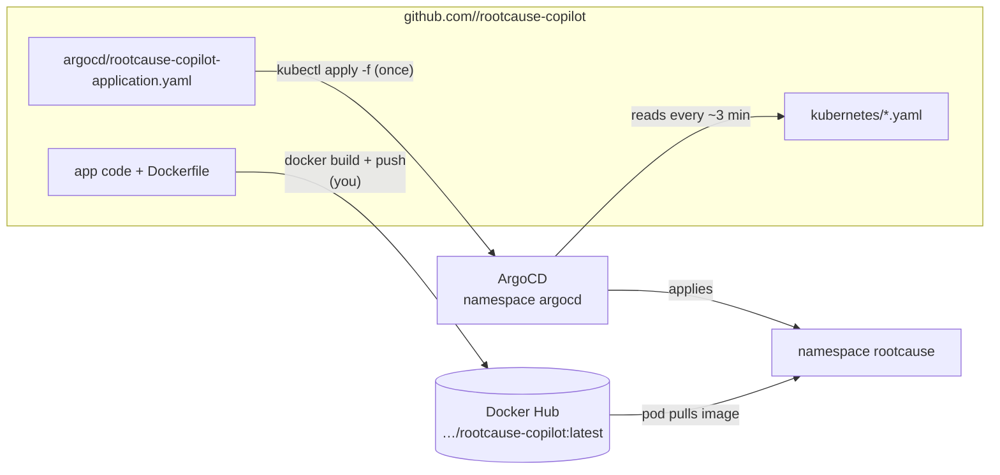
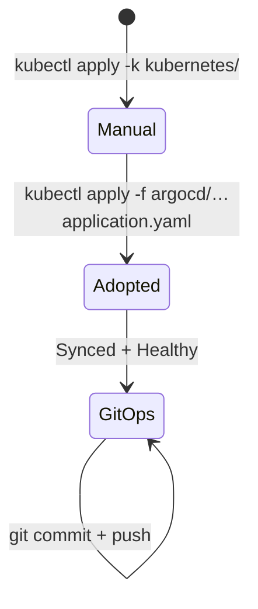

# ArgoCD GitOps - Git as the Source of Truth

How GitOps works for RootCause Copilot. Commands step by step: [README_WINDOWS.md](../README_WINDOWS.md#g-argocd-gitops) ·
[README_MAC.md](../README_MAC.md#g-argocd-gitops-same-repository) · field reference: [argocd/README.md](../argocd/README.md).

## 1. Push vs pull deployment

| | `kubectl apply` (push) | GitOps with ArgoCD (pull) |
|---|---|---|
| Who changes the cluster | a person or a CI job with cluster credentials | ArgoCD, running inside the cluster |
| Record of what changed | your shell history | Git history: who, what, when, why |
| Manual drift | stays until someone notices | detected and reverted (self-heal) |
| Rollback | remember the old YAML | `git revert` |

## 2. One repository, two artefacts

- **GitHub** stores source code and desired state. **Docker Hub** stores the built image.
- ArgoCD never builds images and never reads Docker Hub - Kubernetes pulls the image named in the YAML.
- The course uses **one** repository (`path: kubernetes`). Large organisations often split code and
  configuration into two repositories; that adds access control but also a second place to look.

## 3. The Application

| Field | Value | Meaning |
|---|---|---|
| `repoURL` | `https://github.com/appars/rootcause-copilot.git` (students: their fork) | where the desired state lives |
| `targetRevision` | `main` | branch to follow |
| `path` | `kubernetes` | folder with `kustomization.yaml` - the same one used by `kubectl apply -k` |
| `destination` | `https://kubernetes.default.svc`, namespace `rootcause` | the cluster ArgoCD runs in |
| `automated.selfHeal` | `true` | live changes that differ from Git are reverted |
| `automated.prune` | `false` | resources deleted from Git are **not** deleted from the cluster |
| `CreateNamespace=true` | — | creates `rootcause` if needed |
| `revisionHistoryLimit` | `5` | keeps the last 5 sync records |

**Data protection.** The PVC and the Namespace carry
`argocd.argoproj.io/sync-options: Prune=false,Delete=false`: ArgoCD will neither prune them nor delete them when
the Application is deleted. Deleting the namespace would delete the PVC, so both are protected. The Application has
no deletion finalizer, so `kubectl -n argocd delete application rootcause-copilot` stops management but leaves the
app running.

## 4. From manual deployment to ArgoCD

ArgoCD finds the existing resources with the same names and adds its tracking label - nothing is deleted or
re-created except what really differs. **Ownership rule:** after the hand-over, every change goes through Git.
A later `kubectl apply -k` or `kubectl edit` is drift and self-heal will undo it. Exceptions that do not create
drift: `kubectl rollout restart` (adds only a restart timestamp) and the hand-made Groq Secret (not in Git, never
pruned).

## 5. The three classroom demos

| Demo | What you do | What ArgoCD does | What you see |
|---|---|---|---|
| **Desired-state change** | change `ROOTCAUSE_APP_VERSION` `gitops-v1` → `gitops-v2` in `kubernetes/deployment.yaml`, commit, push | detects the new commit (poll or **Refresh**) → OutOfSync → automatic sync → pod template changed → `Recreate` rollout | sidebar `build gitops-v2` |
| **Self-healing** | `kubectl -n rootcause delete service rootcause-copilot` or scale to 0 | live state ≠ Git → re-applies within seconds | Service back / replicas 1 |
| **Rollback** | `git revert HEAD --no-edit && git push` | syncs the reverted commit | sidebar `build gitops-v1` |

Why `git revert` and not the UI *Rollback* button? With automated sync, ArgoCD would immediately sync forward
to Git again, so the button is disabled. Reverting in Git keeps Git the single truth and leaves an audit trail.

## 6. Images and the `latest` tag

A new image pushed as `latest` is **not** a Git change, so ArgoCD reports nothing. Start a new pod instead:
`kubectl -n rootcause rollout restart deployment/rootcause-copilot`, or ArgoCD UI → Deployment → **⋮ → Restart**.
`imagePullPolicy: Always` makes the new pod pull the newest image. In industry the build pipeline commits an
immutable tag (version or commit SHA) to Git, and ArgoCD rolls it out - the same flow as the release-label demo.

## 7. Sync and health states

| State | Meaning | Usual action |
|---|---|---|
| **Synced** | live = Git | — |
| **OutOfSync** | live ≠ Git | wait for auto-sync, or check the *Diff* |
| **Healthy** | resources report ready (pod Ready, PVC Bound) | — |
| **Progressing** | rollout in progress / PVC waiting for its pod | wait |
| **Degraded** | e.g. `ImagePullBackOff`, `CrashLoopBackOff` | open the pod events / logs |
| **Missing** | in Git, not in the cluster | sync |
| `ComparisonError` | ArgoCD cannot read the repo / render Kustomize | check `repoURL`, branch, path, repository visibility |

## 8. Security notes

- The ArgoCD admin password is initial-only: change it (*User Info → Update password*) and delete
  `argocd-initial-admin-secret` for anything beyond a classroom.
- The repository is public, so it must contain **no** secrets - `kubernetes/` has none, by test.
- ArgoCD is reached only through `kubectl port-forward` on your laptop.
