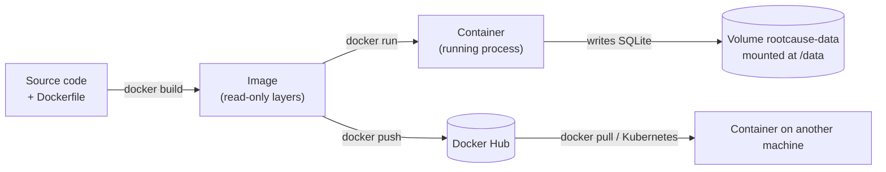
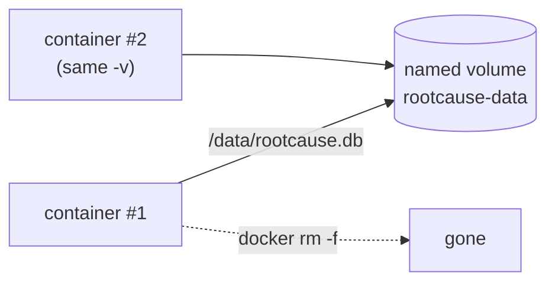

# Docker Deployment - How the RootCause Copilot Image Works

The *why* and *how it works inside*. The step-by-step commands are in [README_WINDOWS.md](../README_WINDOWS.md#d-docker)
and [README_MAC.md](../README_MAC.md#d-docker).

## 1. What a container gives us

| Without Docker | With Docker |
|---|---|
| "Works on my laptop" - Python version, libraries and OS differ per machine | the image carries Python 3.12, every library and the code |
| install steps per student | `docker run` and done |
| Kubernetes cannot run a venv | Kubernetes runs images |

## 2. The Dockerfile, line by line

| Instruction | Why |
|---|---|
| `ARG PYTHON_IMAGE=python:3.12-slim` / `FROM ${PYTHON_IMAGE}` | official, Debian-based *slim* image: small, but `pip` wheels for pyarrow/numpy work (Alpine would need compilers). The argument exists only so a company mirror of the *same* image can be used |
| `ARG APP_VERSION=latest` → `ROOTCAUSE_APP_VERSION` | build label shown in the sidebar; Kubernetes overrides it with a release label |
| `PYTHONDONTWRITEBYTECODE`, `PYTHONUNBUFFERED`, `PIP_NO_CACHE_DIR` | no `.pyc` clutter, logs appear immediately in `docker logs`, smaller layers |
| `ROOTCAUSE_DATA_DIR=/data`, `HOME=/tmp` | SQLite and the app log go to `/data`; Streamlit can write its config cache as a non-root user |
| `groupadd/useradd 10001`, `chown app:app /data` | dedicated unprivileged user that owns only the data directory |
| `COPY requirements.txt` → `pip install` → `COPY . .` | dependency layer is cached; editing code rebuilds only the last layer (seconds instead of minutes) |
| `USER 10001` | the process never runs as root (numeric UID so Kubernetes `runAsNonRoot` can verify it) |
| `EXPOSE 8501`, `--server.address=0.0.0.0` | Streamlit listens on all interfaces - `127.0.0.1` inside a container would be unreachable from outside |
| `VOLUME ["/data"]` | marks where state lives; without `-v`, Docker creates an *anonymous* volume (data then disappears with `docker rm -v`) |
| `HEALTHCHECK … /_stcore/health` | Docker reports `healthy`/`unhealthy`; uses Python's `urllib`, so no `curl` is needed in the image |
| `CMD python -m streamlit run app.py --server.headless=true …` | no browser auto-open, no usage statistics |

## 3. What is kept out of the image (`.dockerignore`)

| Excluded | Reason |
|---|---|
| `.env`, `.env.*`, `.streamlit/secrets.toml`, `*.secret.yaml`, `secrets` | **secrets** - an image is easy to share and every layer can be extracted |
| `data_store`, `*.db`, `*.sqlite` | your local incident memory does not belong to anyone else |
| `.venv`, `venv`, `__pycache__`, caches, `*.log` | built for your laptop's OS; useless or harmful inside Linux |
| `.git`, `.github`, `tests`, `docs`, `kubernetes`, `argocd`, `README*.md`, `requirements-dev.txt` | not needed at run time; smaller image, faster builds |

`data/` (synthetic samples), `.streamlit/config.toml` and the code packages **are** included - the app needs them.

## 4. Persistence

The container's own filesystem is thrown away with the container; the named volume is not. Locally the database
is created on the first page load (`init_db()`), at `/data/rootcause.db`; the redacted technical log is
`/data/logs/app.log`.

## 5. Security properties

| Property | Status |
|---|---|
| Runs as UID 10001, not root | ✅ (`docker exec rootcause id -u` → `10001`) |
| No API key, `.env` or database in any layer | ✅ (key arrives at run time: sidebar, `-e GROQ_API_KEY`, or Kubernetes Secret) |
| Only port 8501 | ✅ |
| Runtime dependencies only (no pytest) | ✅ |
| Read-only root filesystem | ⚪ not enabled - not yet tested with Streamlit; a sensible next hardening step |
| Hash-pinned dependencies, image scanning | ⚪ not in scope; use `pip-audit` / `docker scout` / Trivy in a real pipeline |

## 6. Image tags - why `latest` here, and when not

The course uses one tag, **`DOCKERHUB_USERNAME/rootcause-copilot:latest`**, so students focus on one moving part.

| | `latest` (this course) | versioned tags, e.g. `1.2.0` or the Git commit SHA (industry) |
|---|---|---|
| Simple to type | ✅ | ⚪ |
| Git shows which build runs | ❌ | ✅ |
| Rollback = change one line in Git | ❌ (re-push the old build) | ✅ |
| New build reaches Kubernetes | `imagePullPolicy: Always` + `kubectl rollout restart` | commit the new tag → ArgoCD syncs |

Updating with `latest`: `docker build` → `docker push` → `kubectl -n rootcause rollout restart deployment/rootcause-copilot`.

## 7. CPU architectures

`docker build` produces an image for the CPU of the machine that builds it: **arm64** on Apple Silicon, **amd64**
on Intel/AMD PCs and Intel Macs. Running the wrong one fails with `exec format error` (or runs slowly under
emulation). Publishing to others: build both into one tag with
`docker buildx build --platform linux/amd64,linux/arm64 … --push`, or run the optional *docker-publish* GitHub
workflow. Never force `--platform linux/amd64` for your own laptop.

## 8. Docker vs Rancher Desktop engines

Rancher Desktop with **dockerd (moby)** = the normal `docker` CLI (this course). With **containerd** = `nerdctl`
(same flags; images used by the local cluster live in the `k8s.io` namespace). Images built in one engine are not
visible in the other.

## 9. Common errors

| Error | Cause → fix |
|---|---|
| `Cannot connect to the Docker daemon` / `error during connect` | Desktop app not running or wrong engine/context |
| `invalid reference format` | uppercase letters or spaces in the image name |
| `denied: requested access to the resource is denied` | not logged in, or the name does not start with *your* username |
| container `unhealthy` | `docker logs rootcause`; the app may still be starting (allow 30-60 s) |
| `port is already allocated` | another container/app uses 8501 → `-p 8502:8501` |
| data gone after re-creating | you forgot `-v rootcause-data:/data` (an anonymous volume was used) |
