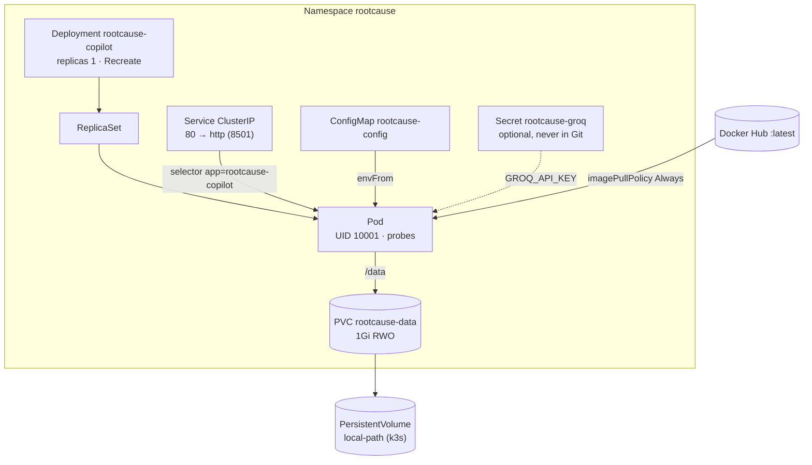

# Kubernetes Deployment - Design of the `kubernetes/` Manifests

Why each manifest looks the way it does. Commands step by step: [README_WINDOWS.md](../README_WINDOWS.md#f-kubernetes-on-rancher-desktop) ·
[README_MAC.md](../README_MAC.md#f-kubernetes-on-rancher-desktop) · file list: [kubernetes/README.md](../kubernetes/README.md).

## 1. The picture



## 2. Decisions and trade-offs

| Decision | Why | Trade-off |
|---|---|---|
| **1 replica** | SQLite is a single-file, single-writer database on a `ReadWriteOnce` volume | no high availability; a PostgreSQL design would allow several replicas (deliberately deferred). CodeForge Agents runs 2 replicas because it is stateless - not copied here |
| **`Recreate` strategy** | the old pod releases the volume before the new one mounts it; a `RollingUpdate` would briefly run two pods on one SQLite file | a few seconds of downtime per rollout |
| **`image: docker.io/DOCKERHUB_USERNAME/rootcause-copilot:latest`** in `deployment.yaml` | one obvious line to edit; no Kustomize image indirection | `latest` does not record which build runs (see [DOCKER_DEPLOYMENT.md](DOCKER_DEPLOYMENT.md#6-image-tags---why-latest-here-and-when-not)) |
| **`imagePullPolicy: Always`** | with a moving tag, each new pod must ask the registry for the newest image | needs Docker Hub reachable at pod start (only the manifest is fetched if layers are cached) |
| **startup / readiness / liveness probes** on `/_stcore/health` | startup allows 150 s for the first start; readiness keeps traffic away until ready; liveness restarts a hung app | — |
| **requests 250m / 512Mi, limits 1 CPU / 1Gi** | fits a laptop cluster; protects it from a runaway process | a heavy PDF report may need more memory (`OOMKilled` → raise the limit in Git) |
| **Pod securityContext** `runAsNonRoot`, UID/GID 10001, `fsGroup: 10001`, seccomp `RuntimeDefault` | matches the image user; `fsGroup` makes the volume writable for it | — |
| **Container securityContext** `allowPrivilegeEscalation: false`, `capabilities.drop: [ALL]`, not privileged | least privilege | `readOnlyRootFilesystem` not enabled (untested with Streamlit) |
| **`automountServiceAccountToken: false`** | the app never calls the Kubernetes API, so it gets no credentials | — |
| **ClusterIP Service + port-forward** | nothing exposed beyond your laptop; the app has no login | not reachable by others (an Ingress + authentication would be needed) |
| **PVC 1Gi, default storage class** | works on k3s (`local-path`) and Docker Desktop (`hostpath`) | data lives on the single node |
| **Secret optional, created by hand** | the app runs without it (Demo Mode / sidebar key); a Secret in Git is a leaked key | must be recreated per cluster |
| **`ROOTCAUSE_APP_VERSION: gitops-v1`** env | visible release label for the GitOps demo - changing it changes the pod template | — |

## 3. Kustomize

`kustomization.yaml` only lists resources. The same folder serves both paths:

| | Manual | GitOps |
|---|---|---|
| Who applies | you: `kubectl apply -k kubernetes/` | ArgoCD, from Git |
| Preview | `kubectl kustomize kubernetes/` | ArgoCD *App diff* |
| Changes | edit + apply again | edit + commit + push |

Use the manual path to learn, then hand over to ArgoCD ([ARGOCD_GITOPS.md](ARGOCD_GITOPS.md#4-from-manual-deployment-to-argocd)).
Do not mix them afterwards.

## 4. Secrets: what base64 really means

```bash
echo -n "hello" | base64          # aGVsbG8=
echo "aGVsbG8=" | base64 -d       # hello  (macOS older: -D)
```

A Kubernetes Secret stores values base64-*encoded* so binary data fits into YAML. Anyone who can read the Secret can
decode it instantly. Protection comes from **RBAC** (who may read Secrets), optional encryption at rest on the
cluster, and **never committing** Secret YAML. Creation commands for bash/zsh and PowerShell are in
[kubernetes/README.md](../kubernetes/README.md#the-optional-groq-api-key-secret-never-committed). If a key leaks,
**rotate it** (create a new one, delete the old one) - deleting the commit is not enough.

## 5. Day-2 operations

| Task | Command |
|---|---|
| Status | `kubectl -n rootcause get pods,deploy,svc,pvc` |
| Why is the pod not running? | `kubectl -n rootcause describe pod -l app=rootcause-copilot` (read *Events*) |
| Logs (previous crash) | `kubectl -n rootcause logs deploy/rootcause-copilot [--previous]` |
| Open the app | `kubectl -n rootcause port-forward svc/rootcause-copilot 8501:80` |
| New `:latest` image | `kubectl -n rootcause rollout restart deployment/rootcause-copilot` |
| Watch a rollout | `kubectl -n rootcause rollout status deployment/rootcause-copilot` |
| Inspect the data | `kubectl -n rootcause exec deploy/rootcause-copilot -- ls -l /data` |
| Remove the app but keep data | `kubectl -n rootcause delete deploy,svc,cm --all` (PVC stays) |
| Remove everything incl. data | `kubectl delete namespace rootcause` ⚠ |

## 6. What this does not provide

High availability, autoscaling, backups of the SQLite file, network policies, an Ingress with TLS, authentication
and image signing. Each is a reasonable production addition and out of scope for the workshop.
